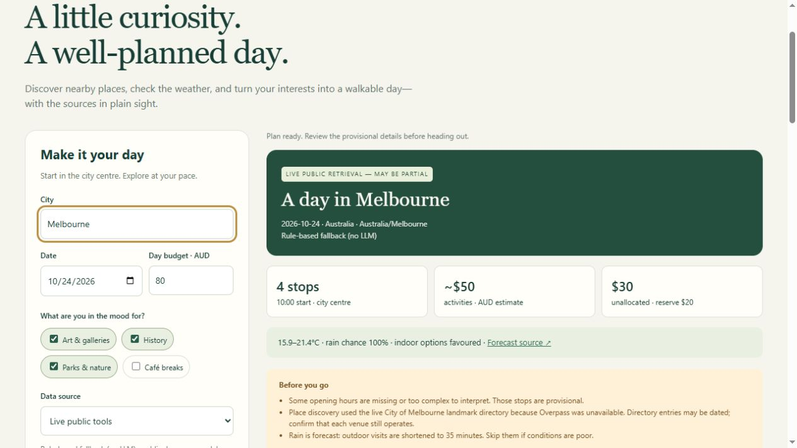
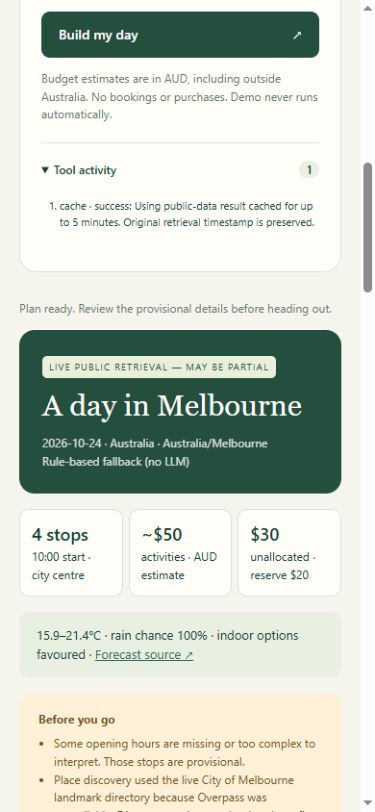

# Public release verification — 24 October 2026

Public app: https://arambya-ai-agent.glossychar1.chatgpt.site

Repository: https://github.com/kallurayaankit/ArambyaAIAgent

## Verified result

The deployed server-backed workflow was exercised through the actual public URL in a browser. Melbourne, 2026-10-24, AUD 80, art/history/nature returned four provisional stops from 47 live city-directory candidates, a live weather forecast, sourced State Library Victoria regular hours, and seven event date-range matches. No LLM was called. The public version explicitly labels its rule-based fallback.

The first deployment exposed an edge-runtime incompatibility: Cloudflare Workers does not accept `fetch` with `redirect: 'error'`. Version 2 fixes this by requesting manual redirects and treating non-2xx responses as tool failures. A regression assertion checks that redirect handling stays explicit. The final Sites source commit is `d2cde563088a52c8ba79f8a311e176325650700d`.

## Checks performed

- 18 automated Node tests passed locally, and the Node build passed.
- GitHub Actions tests/build passed on Node 22 and 24 for source commit `cd82830f7e43ae657838ab4c66ad11064ae3485b`: https://github.com/kallurayaankit/ArambyaAIAgent/actions/runs/40091987345
- The hosted Vinext/Worker build passed, and Sites reported successful public deployment of version 2.
- Anonymous HTTP requests to the public UI and `/api/config` returned 200 without credentials.
- Desktop live browser workflow showed geocoding, places, weather, events, fallback, official-hours lookup and scheduling activity.
- Markdown and JSON export buttons downloaded files; the files were read back to verify mode, timestamp, four stops, seven events, warnings and sources. A sample Markdown export is included here.
- Representative weather, place-directory, official-hours and event source URLs were checked separately.
- At a 390px viewport the layout became one column (335px content column, 375px document width), without horizontal overflow. The mobile workflow completed successfully.
- Invalid demo-city input displayed a validation error and cleared the prior result.
- A nonexistent live city returned a clear lookup error, without substituting demo data.
- Cancellation during a live request restored the UI. A subsequent request completed; a cache hit was explicitly labelled and retained its original retrieval timestamp.
- Explicit demo mode produced an `OFFLINE DEMO — ILLUSTRATIVE DATA` result and logged that no public tools or model were called.

## Source audit

The staged source was reviewed and scanned before upload. No credential-like values or excluded runtime paths were found in 143 tracked source files. Credentials, `.env`, runtime folders, local test output and machine-specific verification notes were excluded. The hosted tree came from its tracked source archive, not its dependency/runtime folders. This is a practical source audit, not a guarantee from a comprehensive security review.

## Known boundaries

- Overpass was unavailable during verification; the live Melbourne directory fallback succeeded. Directory entries may be dated.
- Most opening hours remain unknown; one fallback venue has a dedicated official-hours adapter. Holiday hours are unverified.
- Budgets are approximate AUD allowances and walking times are heuristics. Events are a limited shortlist, not a complete calendar or booking result.
- Public results can be cached for five minutes per server isolate. Rate/concurrency safeguards are prototype-level, not distributed abuse prevention.
- No cloud LLM is enabled. The optional local-model adapter was tested only with mocks.
- PDF saving through the browser print dialog was not tested. JSON and Markdown exports were tested.

